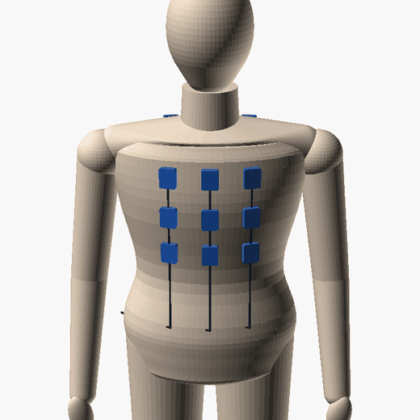
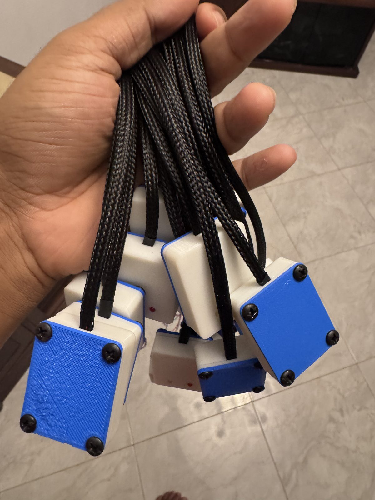
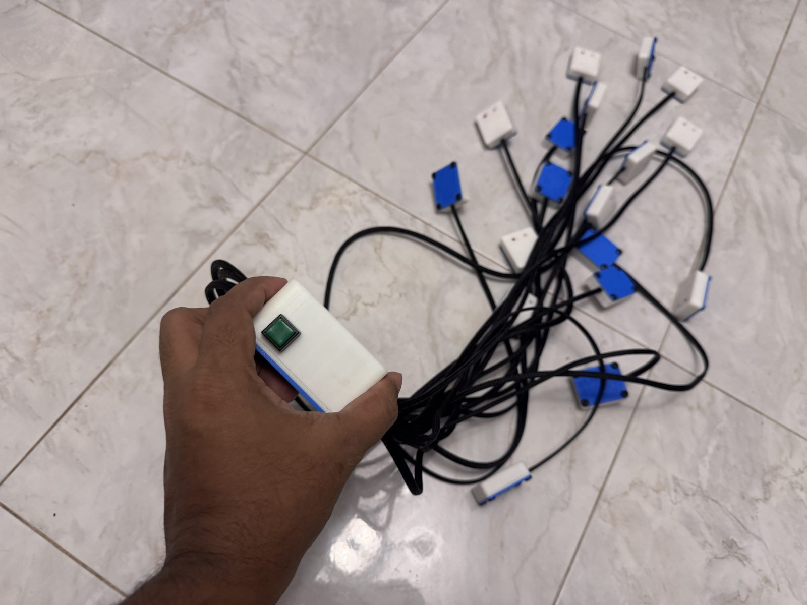
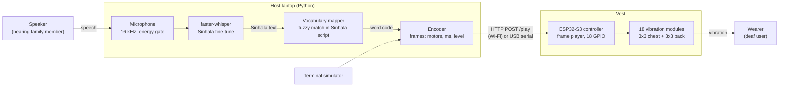
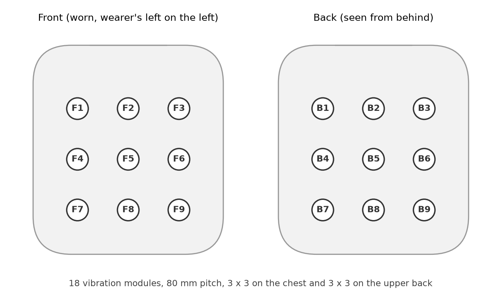
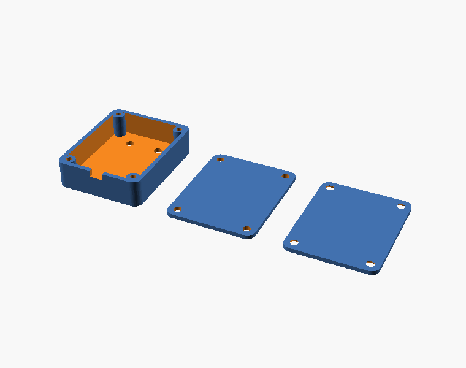
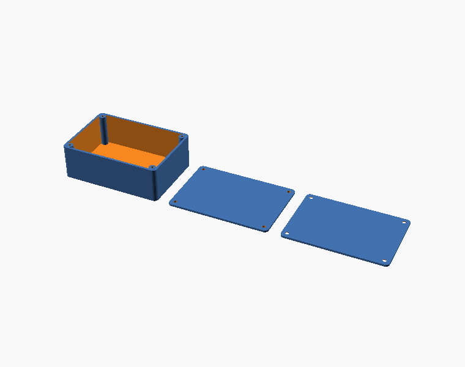

# Sinhala Speech-to-Haptic System for the Hearing Impaired

**A wearable vest that lets a deaf person feel spoken Sinhala as vibration.**
A laptop recognises speech, maps each word of a closed vocabulary to a short vibration pattern, and an
ESP32-S3 plays the pattern on 18 vibration modules arranged as a 3 x 3 grid on the chest and a 3 x 3
grid on the upper back.

<p align="center">
  
  
  
</p>
<p align="center"><sub>Left: module placement on a mannequin (render from <code>hardware/mannequin/mannequin.scad</code>). Middle and right: the prototype harness, September 2026.</sub></p>

| | |
|---|---|
| Lab | Intelligent Systems & Mechatronics Research Laboratory (ISMR Labs) |
| Status | 17-module prototype harness built and chase-tested (24 Sep 2026). Encoding, vocabulary, firmware and host tools done (10 Oct 2026). Garment fitting and the user study are next. No perception data yet. |
| Paper | [paper/haptic-vest.pdf](paper/haptic-vest.pdf) (IEEE conference style, source in `paper/`) |
| Target users | Deaf and hard-of-hearing people in Sinhala-speaking households. Hearing people do not wear it. |

---

## Contents

1. [What we are trying to do](#1-what-we-are-trying-to-do)
2. [How we are doing it](#2-how-we-are-doing-it)
3. [System architecture](#3-system-architecture)
4. [Hardware](#4-hardware)
5. [Encoding: words as vibration](#5-encoding-words-as-vibration)
6. [Firmware](#6-firmware)
7. [Host software](#7-host-software)
8. [User study](#8-user-study)
9. [Results so far](#9-results-so-far)
10. [Known problems and next steps](#10-known-problems-and-next-steps)
11. [Repository layout](#11-repository-layout)
12. [Getting started](#12-getting-started)
13. [References](#13-references)
14. [Licence and citation](#14-licence-and-citation)

---

## 1. What we are trying to do

The 2012 census counted about 389 000 Sri Lankans with a hearing difficulty, 21 per 1000 people.
Most live in Sinhala-speaking homes where the hearing family members do not sign, and the
Sinhala-speaking deaf community has no fully standardised sign language and very few interpreters.
In daily life a deaf family member lip-reads, writes, or is left out of what is said.

Speech can be delivered through the skin. This has been shown since Geldard's Vibratese in 1957,
and recent phoneme-level displays such as TAPS reach 86 % phoneme recognition after a few hours of
training in English. Nothing of the kind exists for Sinhala, and nothing is cheap enough or simple
enough for a household.

**Research questions**

1. Can a wearer learn to identify a closed set of 20 spoken Sinhala words delivered as two-frame
   vibration patterns on 18 torso motors, and how many sessions does it take?
2. Which words are confused, and does a mnemonic codebook (for example *come* = back-to-front
   motion) learn faster than a codebook optimised for geometric separation?
3. Is a Sinhala speech recogniser accurate enough on a closed vocabulary in a home environment to
   drive the vest, or is keyword spotting needed?

**What this repository holds**

- the vest design: wiring, bill of materials, 3D-printed enclosures (SCAD, STL, renders, G-code),
- the controller firmware (ESP32-S3) and the host software (Sinhala ASR, vocabulary mapper,
  transports, terminal simulator),
- the encoding scheme, the codebook generator and the 20-word vocabulary,
- the user study protocol and analysis script,
- a paper describing the design, and an annotated literature list.

## 2. How we are doing it

| Stage | Goal | Status |
|---|---|---|
| 1. Actuator array | 18 vibration modules in printed pods on 1 m leads, driven by an ESP32-S3 | 17 built and chase-tested |
| 2. Encoding | A word-level codebook that respects torso acuity and ERM motor timing | Done (v0, 20 words) |
| 3. Controller firmware | Play timed frame sequences received over Wi-Fi or serial | Done, compiles; to be flashed |
| 4. Host pipeline | Microphone, Sinhala ASR, vocabulary match, send to vest; terminal simulator | Done |
| 5. Garment | Two-layer vest with Velcro grid, controller in a hip pocket | Next |
| 6. ASR check | Closed-vocabulary accuracy of Sinhala Whisper fine-tunes on 10 speakers | Planned |
| 7. Pilot study | 8 hearing lab members, motors masked by noise | Planned |
| 8. Main study | 10 to 12 deaf adults via the Sri Lanka Central Federation of the Deaf | Planned, needs ethics approval |
| 9. Codebook v1 | Re-code confused pairs; test mnemonic codes | After the pilot |

### Design decisions

- **Words, not phonemes.** The skin's throughput is well below what continuous speech needs, and
  phoneme displays reach about one word per minute even after long training. A closed vocabulary
  of the words a deaf person needs most (calls, warnings, needs, yes/no, names) is what can be
  delivered reliably.
- **Torso, coarse grid.** Vibrotactile acuity on the torso is 3 to 4 cm and simple patterns are
  recognised almost perfectly there, even while walking. An 80 mm pitch is conservative.
- **Two frames per word, one or two motors per frame.** Longer than the motor spin-up, short
  enough to keep a word under 0.6 s, and few enough active motors to localise.
- **Recognition on the laptop, timing on the vest.** The model can be swapped without reflashing;
  network jitter never reaches the rhythm inside a word.
- **Open everything** so the codebook, the hardware and the study can be reproduced and improved.

## 3. System architecture



The host sends one line per word, for example `G 80;F 14 200 255;F 12,13 200 255` for ඔව් (yes):
gap 80 ms, motor B6 for 200 ms, then B4+B5 for 200 ms. The protocol is in
[docs/protocol.md](docs/protocol.md).

## 4. Hardware

### 4.1 Actuators and controller

| Part | Choice | Why |
|---|---|---|
| Vibration modules | 18 x 3-pin modules (VCC, GND, IN) with a 10 mm coin ERM motor and on-board transistor | one GPIO per module, no driver board; 150 to 200 Hz sits on the sensitive part of the Pacinian curve |
| Controller | ESP32-S3 DevKitC | 20 free GPIOs, Wi-Fi, USB-C; same toolchain as the lab's other nodes |
| Power | 5 V 3 A USB power bank | two motors per frame draw about 160 mA; 470 uF decoupling at the box |
| Enclosures | printed pod per module (32.5 x 40.5 x 10 mm), controller box (102 x 71 x 35 mm) | pods hold the module flat against the shirt; see `hardware/enclosures` |
| Harness | 3-core wire in 4 mm braided sleeving, about 1 m per module | routes inside the vest to the hip pocket |
| Garment | two-layer sports vest with Velcro patches | pitch adjustable per wearer |

Full list with prices: [hardware/bom.md](hardware/bom.md). Wiring and pin table:
[docs/wiring.md](docs/wiring.md).

### 4.2 Motor layout



`hardware/mannequin/mannequin.scad` places the pods, leads and controller box on a parametric
mannequin (pitch and grid heights are variables) and is rendered to the turntable animation at the
top of this page with `tools/render_mannequin.py` (needs a local OpenSCAD).

Indices 0 to 8 are F1 to F9 (chest, row-major from the wearer's top-left), 9 to 17 are B1 to B9
(upper back). The centre column sits on the midline, where localisation is best.

### 4.3 Enclosures

| Module pod (v11) | Controller box |
|---|---|
|  |  |

OpenSCAD sources, STL, renders and the printed G-code are in
[hardware/enclosures](hardware/enclosures). Build photos: [media](media/README.md).

## 5. Encoding: words as vibration

A word is **two frames of 200 ms** separated by an 80 ms gap; each frame switches on one motor or
an adjacent pair on one side of the body; words are 400 ms apart. The alphabet of 18 singles and
24 pairs gives 1764 possible codes. `tools/make_patterns.py` assigns codes to the 20 words so that
the minimum pairwise distance (Jaccard distance of the motor sets in each frame, plus 1 if the
front/back sequence differs) is as large as possible: **2.0 of 3.0**, so any two words differ in at
least two of their three cues.


All 20 codes: [docs/figures/patterns-all.png](docs/figures/patterns-all.png). The reasoning, the
reserved signals and the growth path (three frames, intensity, category prefix) are in
[docs/pattern-design.md](docs/pattern-design.md). The vocabulary itself is
[patterns/vocabulary.json](patterns/vocabulary.json).

| # | Sinhala | English | # | Sinhala | English |
|---|---|---|---|---|---|
| 1 | ඔව් | yes | 11 | හොඳයි | good / OK |
| 2 | නැහැ | no | 12 | කන්න | eat |
| 3 | එන්න | come | 13 | බොන්න | drink |
| 4 | යන්න | go | 14 | වතුර | water |
| 5 | නවත්වන්න | stop | 15 | අම්මා | mother |
| 6 | ඉන්න | wait / stay | 16 | තාත්තා | father |
| 7 | උදව් | help | 17 | කොහෙද | where |
| 8 | අනතුර | danger | 18 | මොකක්ද | what |
| 9 | ආයුබෝවන් | hello | 19 | දැන් | now |
| 10 | ස්තූතියි | thank you | 20 | පස්සේ | later |

## 6. Firmware

`firmware/vest_controller/vest_controller.ino` (Arduino-ESP32 3.x, board "ESP32S3 Dev Module"):

- 18 GPIO outputs in harness order, 100 Hz software PWM for level, millisecond-timed frame player
  with a 32-frame buffer;
- the same text protocol over HTTP (`POST /play`, `/stop`, `/test`, `GET /status`, mDNS
  `vest.local`) and over USB serial;
- chase test, status, and an on-board LED that follows frame activity.

`firmware/pin_chase/` is the September bring-up sketch that fires each GPIO in turn.
Copy `secrets.h.example` to `secrets.h` with the Wi-Fi credentials before compiling.

## 7. Host software

`host/` (Python 3.10+):

| File | Role |
|---|---|
| `vest_cli.py` | command line: `words`, `play`, `text`, `listen`, `chase`, `status` |
| `patterns.py` | vocabulary loading, Sinhala tokeniser, fuzzy lookup, wire encoding |
| `sender.py` | HTTP, serial (opens the port without toggling DTR/RTS) and terminal simulator |
| `asr.py` | microphone capture, energy-gate utterance cutting, faster-whisper with `language="si"` |

```bash
python host/vest_cli.py words                                   # the codebook
python host/vest_cli.py text "අම්මා එන්න" --vest sim             # simulator: prints the grids
python host/vest_cli.py text "අම්මා එන්න" --vest vest.local      # real vest over Wi-Fi
python host/vest_cli.py listen --vest vest.local --model <sinhala-whisper-ct2>
```

`--model` accepts any CTranslate2 Whisper directory; public Sinhala fine-tunes on Hugging Face
(for example `seniruk/whisper-medium-si-v2`, converted with `ct2-transformers-converter`) report
about 22 % WER on open text. Words outside the vocabulary trigger the `_unknown` signal.

## 8. User study

[study/protocol.md](study/protocol.md): a pilot with 8 hearing lab members (motors masked by
noise), then 10 to 12 deaf adults recruited through the Sri Lanka Central Federation of the Deaf,
three sessions each (familiarisation, training with feedback, identification test, sentence
recall), with 24 h and 48 h retention. Primary measure: identification accuracy and the 20 x 20
confusion matrix. Success for v0: above 80 % at session three and no pair confused above 25 %.
`study/analyse.py` summarises the CSV log.

## 9. Results so far

- 24 Sep 2026: 17 modules on 1 m leads, pods and controller box built; chase test on the
  ESP32-S3 fired every module; the three strapping pins boot normally with the modules attached.
  Photos and videos in `media/`.
- 10 Oct 2026: encoding v0 and the 20-word codebook (minimum distance 2.0); firmware compiles
  (73 % of flash); host tools verified on the terminal simulator, including fuzzy lookup of
  ASR-style misspellings (ස්තුතියි → ස්තූතියි).
- No perception or ASR results yet.

Build log: [docs/experiment-log.md](docs/experiment-log.md).

## 10. Known problems and next steps

- The harness has 17 modules; the 18th (B9, GPIO 2) is wired in firmware but not built.
- ERM motors couple amplitude and frequency and take 50 to 100 ms to start, so the intensity
  dimension is unused; LRAs with a DRV2605L driver are the planned upgrade.
- Supply dips from motor start-up may reset the ESP32: add 470 uF at the box before testing with
  two motors per frame.
- Sinhala ASR is the weakest link. Closed-vocabulary accuracy must be measured before the study,
  and a keyword-spotting model is the fallback.
- The codebook is arbitrary with respect to meaning; a mnemonic variant will be compared.
- Ethics approval is required before the main study; the pilot uses lab members only.

## 11. Repository layout

```
README.md
paper/               haptic-vest.tex, references.bib, figures/, haptic-vest.pdf
docs/                pattern-design.md, protocol.md, wiring.md, references.md, experiment-log.md, figures/
hardware/            bom.md, enclosures/ (vibration-motor-enclosure, controller-box, gcode), mannequin/ (placement model)
firmware/            vest_controller/ (ESP32-S3), pin_chase/ (bring-up test)
host/                vest_cli.py, patterns.py, sender.py, asr.py, requirements.txt
patterns/            vocabulary.json (generated by tools/make_patterns.py)
study/               protocol.md, analyse.py
tools/               make_patterns.py (codebook), make_figures.py (figures), render_mannequin.py (turntable GIF)
media/               mannequin-turntable.gif, photos/, video/ (poster frames; full videos on the GitHub release)
CITATION.cff, LICENSE
```

## 12. Getting started

```bash
git clone https://github.com/ISMR-Labs/Sinhala-Speech-to-Haptic-System-for-the-Hearing-Impaired.git
cd Sinhala-Speech-to-Haptic-System-for-the-Hearing-Impaired
python3 -m venv .venv && . .venv/bin/activate
pip install -r host/requirements.txt          # numpy, requests, pyserial, sounddevice, faster-whisper

# 1. try the codebook without hardware
python host/vest_cli.py words
python host/vest_cli.py text "ඔව් උදව්" --vest sim

# 2. flash the controller (Arduino-ESP32 core 3.x)
cp firmware/vest_controller/secrets.h.example firmware/vest_controller/secrets.h   # edit Wi-Fi
arduino-cli compile --fqbn esp32:esp32:esp32s3 firmware/vest_controller
arduino-cli upload  --fqbn esp32:esp32:esp32s3 -p /dev/cu.usbmodem* firmware/vest_controller

# 3. check the wiring, then play
python host/vest_cli.py chase --vest vest.local
python host/vest_cli.py text "අම්මා එන්න" --vest vest.local
python host/vest_cli.py listen --vest vest.local --model small     # or a Sinhala fine-tune

# regenerate the codebook and figures after editing tools/make_patterns.py
python tools/make_patterns.py && python tools/make_figures.py
```

## 13. References

Annotated list with notes on relevance: [docs/references.md](docs/references.md).

**Tactile speech and sensory substitution**

1. Geldard, F. A. (1957). Adventures in tactile literacy. *American Psychologist* 12(3): 115–124. https://doi.org/10.1037/h0040416
2. Summers, I. R. (ed.) (1992). *Tactile Aids for the Hearing Impaired.* Whurr, London.
3. Reed, C. M., Tan, H. Z., Perez, Z. D., et al. (2019). A phonemic-based tactile display for speech communication. *IEEE Transactions on Haptics* 12(1): 2–17. https://doi.org/10.1109/TOH.2018.2861010
4. Tan, H. Z., Reed, C. M., Jiao, Y., et al. (2020). Acquisition of 500 English words through a TActile Phonemic Sleeve (TAPS). *IEEE Transactions on Haptics* 13(4): 745–760. https://doi.org/10.1109/TOH.2020.2973135
5. Novich, S. D., Eagleman, D. M. (2015). Using space and time to encode vibrotactile information: toward an estimate of the skin's achievable throughput. *Experimental Brain Research* 233(10): 2777–2788. https://doi.org/10.1007/s00221-015-4346-1
6. Perrotta, M. V., Asgeirsdottir, T., Eagleman, D. M. (2021). Deciphering sounds through patterns of vibration on the skin. *Neuroscience* 458: 77–86. https://doi.org/10.1016/j.neuroscience.2021.01.008

**Vibrotactile perception on the torso**

7. van Erp, J. B. F. (2005). Vibrotactile spatial acuity on the torso: effects of location and timing parameters. *Proc. WHC 2005*, 80–85. https://doi.org/10.1109/WHC.2005.144
8. van Erp, J. B. F. (2005). Presenting directions with a vibrotactile torso display. *Ergonomics* 48(3): 302–313. https://doi.org/10.1080/0014013042000327670
9. Jones, L. A., Lockyer, B., Piateski, E. (2006). Tactile display and vibrotactile pattern recognition on the torso. *Advanced Robotics* 20(12): 1359–1374. https://doi.org/10.1163/156855306778960563
10. Jóhannesson, Ó. I., et al. (2017). Relative vibrotactile spatial acuity of the torso. *Experimental Brain Research* 235: 3505–3515. https://doi.org/10.1007/s00221-017-5073-6
11. Cholewiak, R. W., Brill, J. C., Schwab, A. (2004). Vibrotactile localization on the abdomen: effects of place and space. *Perception & Psychophysics* 66(6): 970–987. https://doi.org/10.3758/BF03194989
12. Makous, J. C., Friedman, R. M., Vierck, C. J. (1995). A critical band filter in touch. *Journal of Neuroscience* 15(4): 2808–2818.

**Sinhala speech recognition**

13. Kjartansson, O., et al. (2018). Crowd-sourced speech corpora for Javanese, Sundanese, Sinhala, Nepali, and Bangladeshi Bengali. *Proc. SLTU 2018*, 52–55. https://doi.org/10.21437/SLTU.2018-11
14. Warusawithana, D., Kulaweera, N., Weerasinghe, L., Karunarathne, B. (2022). A systematic approach to derive a refined speech corpus for Sinhala. *Proc. LREC 2022*, 5107–5113. https://aclanthology.org/2022.lrec-1.546
15. Radford, A., et al. (2023). Robust speech recognition via large-scale weak supervision. *Proc. ICML 2023*, PMLR 202: 28492–28518.
16. Babu, A., et al. (2022). XLS-R: self-supervised cross-lingual speech representation learning at scale. *Proc. Interspeech 2022*, 2278–2282. https://doi.org/10.21437/Interspeech.2022-143

**Context**

17. Department of Census and Statistics, Sri Lanka (2012). *Census of Population and Housing 2012: disability tables.*
18. Sri Lanka Central Federation of the Deaf: population and interpreter estimates.

## 14. Licence and citation

MIT licence for code, designs and documents (see [LICENSE](LICENSE)). Photos are CC BY 4.0.
Cite with the metadata in [CITATION.cff](CITATION.cff).
