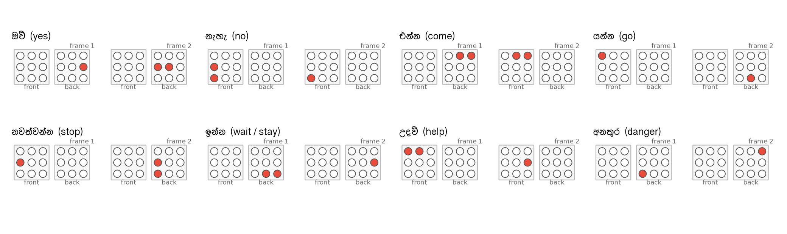

# Pattern design

## What the skin can resolve

The design is bounded by three facts from the vibrotactile literature (full citations in
[references.md](references.md)):

1. **Spatial acuity on the torso is 3 to 4 cm** for successive stimuli, and localisation of a single
   stimulus is within about 5 cm (van Erp 2005; Jóhannesson et al. 2017 found relative acuity down
   to about 13 mm tactor spacing under good conditions). A 3 x 3 grid at 80 mm pitch is therefore
   well inside what people can tell apart, front and back.
2. **Patterns on the torso are recognised almost perfectly** when they are simple: 99 to 100 % for
   seven of eight navigation patterns on a torso display (Jones, Lockyer and Piateski 2006), and
   accuracy barely drops when the wearer is moving.
3. **Throughput is low.** Estimates of the skin's achievable rate are below what continuous speech
   needs, even with both spatial and temporal coding (Novich and Eagleman 2015). Phoneme-level
   displays on the forearm reach about 86 % recognition of 39 phonemes after 1 to 4 h of training
   (Reed et al. 2019) and up to 500 words after longer training (Tan et al. 2020), but word rates
   stay around one word per minute for free text.

The consequence for a 18-motor vest is that we should **not** try to transmit Sinhala phoneme by
phoneme. We transmit whole words from a closed vocabulary, which is what a deaf wearer needs most
in everyday situations: calls, warnings, yes/no, basic needs and names. This is the same decision
Geldard made in 1957 with Vibratese, which coded letters and the most common words directly.

## Encoding v0

| Parameter | Value | Reason |
|---|---|---|
| Motors | 18 (9 front, 9 back), 3 x 3 each, 80 mm pitch | acuity, and the harness as built |
| Frame | 200 ms on | longer than the 50 to 100 ms ERM spin-up, short enough for two frames per word |
| Gap | 80 ms between frames | lets the motor stop so the second frame is felt as a separate event |
| Word gap | 400 ms | separates words in a sentence |
| Frames per word | 2 | 20 words fit comfortably; capacity is 42 x 42 = 1764 codes |
| Motors per frame | 1 or an adjacent pair (horizontal or vertical) | single motors are the most localisable; pairs add a "wide" feature |
| Level | fixed at full | intensity is reserved as a third dimension for a later version |

A word is therefore "where, then where": a short tap on one spot or a short bar, followed by a
second one, which may be on the other side of the body. Front-to-back and back-to-front
sequences are the easiest to feel, so the code assignment rewards them.

## Code assignment

`tools/make_patterns.py` builds the candidate frame set (18 singles + 24 adjacent pairs = 42 frames),
forms all two-frame codes, and assigns codes to words greedily so that the **minimum pairwise
distance** between any two words is as large as possible. Distance = sum over the two frame
positions of the Jaccard distance between motor sets, plus 1 when the front/back sequence
differs. For the 20-word v0 vocabulary the minimum distance is 2.0 (out of a maximum of 3.0),
meaning every pair of words differs in at least two of the three cues (first spot, second spot,
side sequence). The search is deterministic.

The assignment is arbitrary with respect to meaning. Mnemonic assignments (for example "come"
moving from back to front, "go" from front to back, "danger" as a wide bar on the chest) are an
obvious alternative and will be tested against the distance-optimal codebook in the study;
mnemonics may speed up learning even if they lower the geometric separation.

All 20 codes: [figures/patterns-all.png](figures/patterns-all.png).

## Reserved signals

| Name | Pattern | Use |
|---|---|---|
| `_listening` | four front corners, 120 ms | the host started listening |
| `_unknown` | whole front, then whole back, 150 ms each | a recognised word is not in the vocabulary |
| `_sentence_end` | centre front, then centre back, 100 ms each | end of an utterance |

## Vocabulary v0 (20 words)

| # | Sinhala | Romanised | English | Category |
|---|---|---|---|---|
| 1 | ඔව් | ow | yes | response |
| 2 | නැහැ | naehae | no | response |
| 3 | එන්න | enna | come | command |
| 4 | යන්න | yanna | go | command |
| 5 | නවත්වන්න | nawathwanna | stop | command |
| 6 | ඉන්න | inna | wait / stay | command |
| 7 | උදව් | udaw | help | alert |
| 8 | අනතුර | anathura | danger | alert |
| 9 | ආයුබෝවන් | ayubowan | hello | social |
| 10 | ස්තූතියි | sthuthiyi | thank you | social |
| 11 | හොඳයි | hondayi | good / OK | social |
| 12 | කන්න | kanna | eat | need |
| 13 | බොන්න | bonna | drink | need |
| 14 | වතුර | wathura | water | need |
| 15 | අම්මා | amma | mother | person |
| 16 | තාත්තා | thaththa | father | person |
| 17 | කොහෙද | koheda | where | question |
| 18 | මොකක්ද | mokakda | what | question |
| 19 | දැන් | daen | now | time |
| 20 | පස්සේ | passe | later | time |

The words were chosen for everyday use between a deaf person and family members, not for
frequency in text. The user study will tell us which to replace.

## Growing the vocabulary

- 2 frames with the v0 alphabet: 1764 codes, but perceptual separation falls quickly beyond
  about 40 words.
- 3 frames: a rhythm cue (short-short-long) can be added without new motors.
- Intensity: two levels double the alphabet; needs a perception test with the ERM modules first.
- Category prefix: a first frame that encodes the category (question, command, need) followed by
  the word code, which mirrors how TAPS groups phonemes by place and manner.
