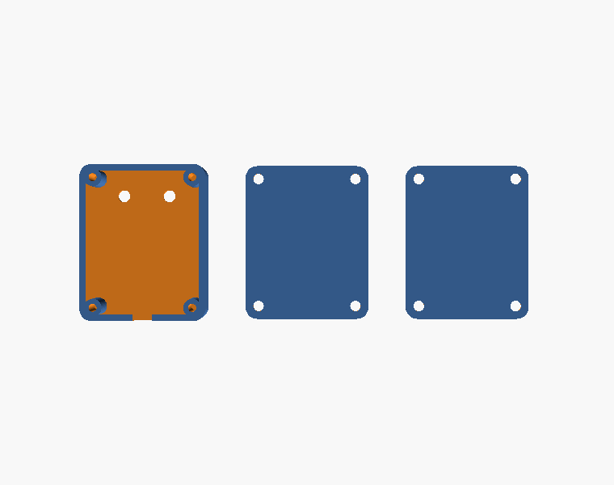
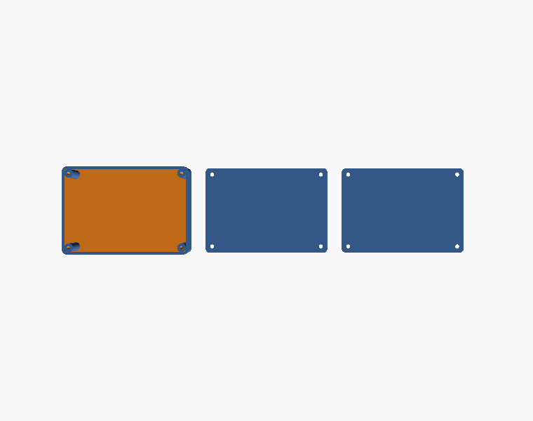

# Enclosures

OpenSCAD parts designed on the lab's Forge service (OpenSCAD to STL to G-code for a Creality
Ender-3 V3 SE, 220 x 220 x 250 mm bed) and printed in PLA+ at 210 °C / 60 °C, 0.20 mm layers.
Each `.scad` builds all parts in one file; set `part` at the top of the file.

| Folder | Part | Outer (mm) | Inner clear (mm) | Fixings | Notes |
|---|---|---|---|---|---|
| `vibration-motor-enclosure/` | Module pod, snap lid, base plate (v11) | 32.5 x 40.5 x 10.1 | 21.1 x 29.1 x 8.6 | 4 x M2.5 self-tapping into Ø4.6 posts | Rim notch for the 4 mm sleeved cable; the base plate carries a Velcro patch. A module must be ≤ 21 x 29 mm |
| `controller-box/` | Controller box, lid, base plate | 101.8 x 70.8 x 34.7 | 52 x 83 x 32 | 4 x M3 corner posts, countersunk base plate | Holds the ESP32-S3 DevKitC, power bank lead and push button; cables leave through lid notches |

`gcode/` holds the sliced files that were printed: `vib_6baseplates.gcode` (six pod base plates
per bed), `controller_box.gcode`, `controller_lid.gcode`, `controller_lid_baseplate.gcode`.

| Module pod | Controller box |
|---|---|
|  |  |
|  |  |

Printing notes

- Pods print lid-down; the lid face is the side that touches the skin through the shirt, so a
  flat first layer matters. Twenty pods fit on two beds.
- Walls are 1.35 mm (3 x 0.45 mm lines) so the slicer fills them with perimeters only.
- The v11 pod was reduced from 36.5 x 46.5 mm (v10); check the module footprint before a batch
  print.

Photos of the printed parts: [media/photos/2026-09-24-vibration-array](../../media/photos/2026-09-24-vibration-array).
